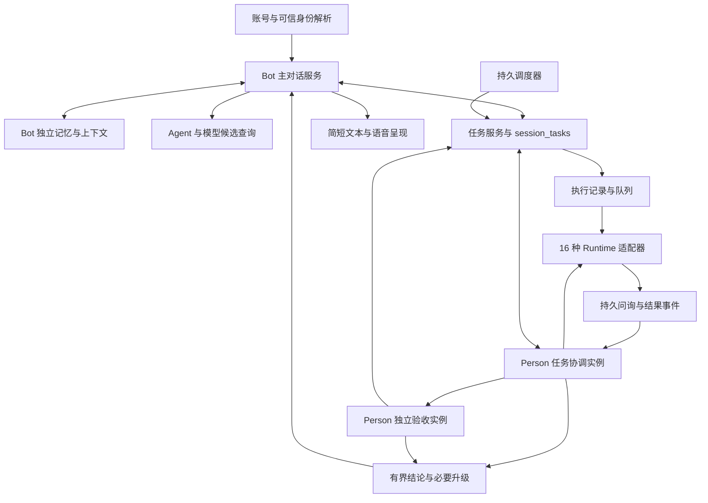

# Person Bot 开发设计与实现记录

日期：2026-10-26

代码基线：`af158b526ab00bcea136a7bd272a08eeb826b6ac`

状态：已实现本地首版，当前实现和验证边界见第 17 节。第 2–16 节保留设计基线，不应把其中的后续扩展视为已实现。

Person Bot 是归属账号的个人助手，负责交流、记忆、任务协调和定时工作。复用 Ekko Runtime 的执行代码，独立管理 Bot 的数据和上下文；任务目标继续使用 `session_tasks`，补齐执行记录、任务级答疑、独立验收和调度机制。

本文用于指导数据迁移、服务拆分、工具接口、运行控制和验收。聊天与未来语音输出保持简短纯文本，开发文档保留便于实现和评审的结构化格式。

## 1 已确认需求与设计边界

以下内容来自本次产品讨论，应作为实施约束。

1. Bot 绑定账号，不能把 Profile 当成 Bot 身份或数据归属。
2. Bot 的长期记忆与现有 Ekko Agent 记忆隔离，不默认互相读写或导入。
3. Bot 需要独立的上下文管理和压缩，覆盖长对话、连续工具调用和多任务回传。
4. Bot 能发现并创建当前可用的 Agent 执行任务。系统已有 16 种 Agent，实际可用性需要动态判断。
5. 一个 provider 可能包含数千个模型，不能把完整目录塞入 Prompt 或工具参数枚举。
6. 任务保留单聊所需的问询等交互能力，不能直接套用工作流执行策略。
7. 复用 `session_tasks` 保存任务目标，Bot 能操作这些任务。
8. 需要明确记录任务是否正在执行，以及等待回答、暂停、中断等执行状态。
9. 需要定时任务，支持 Bot 管理计划并持续跟进执行结果。
10. 面向用户的回答简短、无 Markdown，适合后续接入语音。
11. 子 Agent 的问询先由 Person Agent 回答；主对话、任务协调和任务验收使用独立上下文，不复制整个主聊天。
12. Coding Agent 保留默认免授权执行，不为接入 Bot 增加逐工具或逐命令审批。账号资源访问与用户委派范围仍需明确。

架构建议为新增 Bot 业务模块并组合现有 Runtime。具体表名、接口名、默认限额、部署方式和账号下 Bot 数量属于实现建议或待定项，不视为用户已经确定。

本轮已进入代码实现。首版不扩展自主发现工作、多渠道信息共享、人格市场或跨机器自动迁移执行。

## 2 当前基础与需要补齐的能力

| 领域 | 当前代码事实 | 本次开发要补齐的部分 |
| --- | --- | --- |
| Runtime | `AgentRuntime` 可独立构造，支持注入模型、工具和可选记忆服务 | Bot 专用实例、工具注册表、上下文管理接入点 |
| 记忆 | 现有服务以 `profileId` 及 profile/context/session 作用域组织数据，已有查看、编辑、删除界面 | 账号归属的独立存储、召回与写入规则、Bot 管理界面 |
| 任务目标 | `session_tasks` 已保存标题、摘要、状态、来源消息和完成证据 | 账号/Bot 归属、结构化要求、执行关联和跨会话操作 |
| 任务状态 | 当前目标状态仅有 `open`、`completed`、`closed` | 服务端维护的执行状态，不能从 `open` 推断正在运行 |
| 目标访问 | 现有模型工具绑定当前活跃会话；列表主要通过会话 Profile 过滤 | 账号范围的任务接口及 Bot 执行凭证，保留原有工具边界 |
| 压缩 | Studio 在启动 Ekko 运行前构建压缩历史；Runtime 每步估算后进入模型调用 | 每次模型请求前检查、压缩重建、再次校验与超限恢复 |
| 委派 | Ekko 子任务有独立输入，但后台运行管理使用进程内状态 | 持久执行记录、重启核对、改要求和取消的可靠投递 |
| Agent 目录 | 已有 16 种安装状态和 Coding Agent 原生模型发现适配器 | 将安装、登录、权限、运行方式、模型兼容性合并成可执行能力 |
| 问询 | 单聊已有问询事件；MCP 问询绑定活跃 turn，Ekko 待回答对象存放于内存 | 持久问题、任务协调实例优先回答、必要时升级用户、重启恢复 |
| 验收 | 目标完成需要证据，但没有本文设计的独立任务验收上下文 | 按最新要求检查真实产物、记录验收结论、限制返工循环 |
| 授权 | Ekko 有会话/配置级工具授权；Coding Agent 入口已有跳过原生审批的配置 | 保留 Coding Agent 默认免授权；补齐账号资源归属、任务范围和可信用户决定记录 |
| 定时工作 | 现有工作流调度有 cron、时区、触发占位及事件记录，策略为跳过错过时间和重叠执行 | Bot 任务的调度目标、单次计划、版本控制、原子入队、交互保留 |

当前 `session_tasks.session_id` 和 `source_message_id` 不可为空；删除或清空会话会删除对应任务，删除来源消息也会影响任务。账号级长期任务不能直接继承这套生命周期。迁移规则见第 5 节。

源码依据集中列于第 16 节。实现中以实际能力探测为准，安装状态、目录条目和一次成功运行都不等于持续可用。

## 3 模块职责与身份



Bot 主运行复用 Ekko Runtime。被委派的任务可以选择 Ekko、Hermes 或 Coding Agent，使用各自独立的执行会话。一次 Bot 发言可以管理多个任务，但不能把整个主对话复制给每个执行者。

Person 是一个逻辑身份，不等于一个不断增长的聊天窗口。主对话负责用户交流和跨任务安排；任务协调实例负责某一任务的答疑与推进；验收实例负责某次交付的检查。三者复用身份配置、Runtime 和按需读取的 Bot 记忆，各自拥有上下文、工具范围和预算，不建立三个独立 Bot，也不复制完整人格历史或 Ekko 记忆库。

协调与验收按事件唤醒，完成后保存结构化决定和检查点，不要求常驻进程。协调实例按任务恢复；每次验收从最新要求和产物重新组装上下文，不继承执行者或协调实例的完整对话。角色由服务端注册和调度，模型不能无限创建“分身的分身”。

| 概念 | 身份与职责 |
| --- | --- |
| 账号 | 服务端认证得到的稳定用户主体；决定归属与资源访问范围 |
| Bot | `bot_id` 与账号关联，保存人格、记忆策略和任务偏好 |
| Profile | 可选的执行配置资源；切换它不改变 Bot 身份或记忆归属 |
| 主会话 | 用户与 Bot 的交流记录，可创建多段；不会成为 Bot 唯一身份 |
| 任务目标 | `session_tasks.id`；描述需要交付的结果，可跨会话跟进 |
| 执行记录 | 某次推进目标的尝试，具有独立身份、运行状态和检查点 |
| 执行会话 | 承载具体 Agent 的消息、日志和原生续跑标识 |
| 协调/验收调用 | 同一 Person 身份下的任务级处理，关联目标和具体执行，不成为新的用户目标 |
| 计划 | 保存何时触发某个任务；一次触发对应独立调度 occurrence |

账号标识由认证层解析，工具参数不接受任意 `owner_user_id`。现有 Studio 用户、App/云端用户映射需要在接入层明确，不能用同名 Profile 或未经校验的历史字符串猜测归属。

新增服务放在 `modules/studio` 既有分层内，例如 `services/bot`、`contracts/bot` 和相应 repository。Ekko 内核扩展放在 `packages/ekko-agent`，不反向导入 Studio 业务。具体 Agent 适配器通过 bootstrap 组装，避免 Bot 服务跨模块直接导入实现。

## 4 独立记忆和上下文管理

### 4.1 记忆隔离

Bot 记忆使用 Studio 所属的独立表、索引和服务，不访问现有 Ekko 记忆表，不把 `bot_id` 假装成 `profileId`。所有读写都绑定已认证账号和 `bot_id`，数据存放于 Web UI 状态目录。

可复用预算裁剪、检索排序等纯逻辑。身份校验、来源、写入政策和删除生命周期由 Bot 服务持有。记录至少包含内容、来源引用、版本、状态、作用范围及过期时间；修正时保留可追溯关系，旧条目不再参与召回。

创建 Bot Runtime 时不注入现有 `MemoryService`，不复用已经注册旧记忆工具的 registry。单轮设置 `memoryEnabled: false` 只影响自动记忆路径，不能代替工具和数据隔离。Bot 自己提供记忆查询、写入、纠正与遗忘工具。

任务执行者只获得与任务相关的有限记忆。首版建议执行者返回记忆候选，由 Bot 记忆服务审查后写入；任务日志、工具内容和临时推测不自动成为用户长期偏好。

### 4.2 分离长期记忆和执行检查点

长期记忆记录稳定事实与偏好。检查点记录任务目标、最新要求版本、已完成动作及回执、关键决定、未完成事项、下一步和材料引用。压缩摘要属于上下文材料，不自动升级为长期记忆。

原始聊天、日志、文件保留在各自存储中；摘要保存覆盖范围、来源版本和校验信息。摘要不能递归无限追加，也不能把“准备执行”写成“执行成功”。

### 4.3 每次请求前检查

增加可注入的上下文管理接口，名称可采用 `RuntimeContextController`。Bot 提供组装和压缩策略，Runtime 在每次模型调用前调用该接口，包括工具结果回传后的下一步。现有普通 Ekko 使用默认策略或兼容适配器，不直接切换到 Bot 存储。

```text
持久材料 → 选择相关内容 → 组装完整请求 → 预算检查
                                  ↓ 超过整理阈值
                       保存检查点、移出材料、生成摘要
                                  ↓
                         重建请求并重新检查 → 发送
                                  ↓ 仍不满足
                         保存进度并返回明确限制
```

预算约束为：完整输入 + 输出预留 + 安全余量 ≤ 当前模型上下文上限，并分别满足独立输入、输出限制。工具 schema、结果、多模态输入和供应商隐式历史均需计算，不能只统计聊天正文。

适配器负责模型窗口、计数能力和供应商上下文的处理。最终序列化带来额外内容时，在发送边界补校验。计数不精确时使用保守估计；供应商仍可能拒绝，恢复必须缩减请求或重建供应商上下文，并限制重试次数。

压缩调用有独立预算和分块策略，不能把已超限的全文直接交给同容量摘要模型，也不能递归触发无限压缩。裁剪保留工具调用与结果配对、最新用户要求和不可丢弃的授权边界。

Coding Agent 原生循环不一定暴露逐次请求入口。适配器必须声明原生压缩、用量观测、溢出恢复和检查点续跑能力；无法控制的入口不得声称已获得与 Ekko 相同的逐请求保证。

### 4.4 控制多任务带来的总量

为目录结果、记忆召回、任务状态、待回答问题、任务回传和近期消息分别分配预算，再检查总预算。服务端限制条目数量与每个字段长度；大材料返回引用，禁止无限嵌套结构。

每轮构建有界的当前状态视图。历史查询结果和旧进度不永久堆入 Prompt；完整记录保留，模型只按需取回。多个任务同时结束时合并事件、去重并分批读取，不能每个完成事件都无条件启动一次主 Bot 推理。

任务问答、工具日志、检查过程和返工循环留在任务上下文中，主对话只接收简短交付结论、重要变化和确需用户决定的事项。协调、验收也执行逐请求预算检查；摘要按覆盖范围替换，不能不断追加“摘要的摘要”。独立上下文控制主对话体积，不承诺降低总 token 消耗；每个任务另设协调调用次数、验收轮次、总费用和并发上限。

建议初始目录查询默认返回 3 个候选、最多 10 个；其他限额通过真实场景测量后确定。限额必须覆盖一批结果的总 token，而不是只限制每个任务摘要。预算设置由 Bot 配置统一管理并提供对应管理入口。

## 5 任务数据模型与迁移

### 5.1 复用任务目标

`session_tasks` 是任务目标的唯一记录，不新增一张重复保存同一目标的 Bot tasks 表。建议添加下列字段；字段名称可在实现时对齐仓库规范。

| 字段 | 建议语义 |
| --- | --- |
| `owner_user_id` | 经认证解析的账号归属；旧任务可暂为空，不能猜测回填 |
| `bot_id` | 负责协调的 Bot；空值保持普通会话任务语义 |
| `revision` | 单个任务的并发控制版本，与已有会话 ledger revision 协同维护 |
| `requirements_revision` | 目标、验收标准和约束变更的版本；用于判断运行结果是否过期 |
| `requirements_json` | 有限的目标细节、验收条件、约束和材料引用 |
| `completion_origin` | 区分模型按证据验收与用户手动标记完成 |

保留 `status = open | completed | closed`。`open` 表示仍需处理，不能表示运行中。目标摘要仍是有限文字，不用它承载不断增长的执行历史。

任务与运行是一对多关系。首版建议一个任务同时只有一个有效工作执行尝试，内部并行工作记录为该尝试的子执行；协调和验收调用另以角色关联到这个尝试，不受“同一任务只能有一个工作执行者”误伤。确需多个独立交付物时，创建有明确关系的独立目标。查询接口聚合实际执行状态，避免在目标表维护另一份可随意写入的运行状态。

### 5.2 新增支撑记录

| 记录 | 关键字段和约束 |
| --- | --- |
| Bot | `id`、`owner_user_id`、人格配置、上下文政策、版本 |
| 执行 `task_executions` | `id`、`task_id`、账号、Bot、`role = worker/coordinator/reviewer`、关联工作 execution、要求版本、状态、选择的执行身份、独立上下文/执行会话、原生 run 标识、尝试号、checkpoint、lease/fence、时间戳、结果引用 |
| 执行事件 | execution、事件序号、类别、有限载荷/引用；唯一键去重，更新状态和发布 outbox 同事务 |
| 任务指令 | task、要求版本、来源用户消息、内容/引用、目标 execution、投递状态和回执 |
| 问询 `task_interactions` | task、execution、运行代次、要求版本、类型、问题、选项、状态、有效期、回答者角色、决定引用、回答及投递回执 |
| 任务决定 | task、要求版本、问题/来源消息、决定内容、依据引用、`user/person/policy` 来源、适用范围及版本；Person 的判断不能伪装成用户授予的新权限 |
| 验收记录 | 工作 execution、要求版本、产物版本/摘要、验收调用、逐项证据、pass/rework/needs_user/inconclusive、缺项、返工次数 |
| 任务授权范围 | 账号、Bot、task、可用资源引用、用户委派的动作范围和限制、有效期、来源、版本、撤销状态；不复制原生 CLI 的逐命令审批清单 |
| 调度 `task_schedules` | task、账号/Bot、时间规则、时区、版本、状态、下一次触发时间及执行/通知政策 |
| 调度 occurrence | schedule、计划版本、计划触发时间、处理状态、execution；组合唯一键防重复 |
| Bot 记忆与上下文 | 独立记忆条目、来源、版本；按主会话/任务协调/工作执行/验收分开的摘要与检查点 |

执行身份只保存资源引用和已选定的非敏感参数，密钥仍由现有凭据服务提供。详情、产物和查询游标沿用同一账号访问校验。

### 5.3 旧会话与账号任务共存

采用逐步迁移，普通会话任务继续遵守现有访问和清理规则。Bot 接管既有任务时复用原任务 ID，并检查归属、访问权限和版本；能访问某个共享 Profile 不足以证明拥有其中所有任务。

Bot 管理的目标不应依赖原始会话永久存在。建议将其 `session_id`、`source_message_id` 调整为可空来源引用，并由服务层保证普通会话任务创建时仍必须有来源。迁移需重建受约束的 SQLite 表并验证数据、索引和旧接口兼容性，不能只添加可选 TypeScript 字段。

会话删除/清空和消息删除路径需要区分两类目标。普通目标保持原有行为；Bot 目标按“仅删除聊天”或“同时删除任务”的明确用户意图处理。保留任务时断开已删除来源引用；用户删除的原文不能偷偷复制进检查点继续保留。若唯一完成证据被删除，按规则重新核验或恢复为未完成。

现有模型工具仍限定当前会话，不扩展成可传任意 session 的全局工具。新 Bot 接口以账号范围授权。旧列表和更新接口也必须识别 Bot 归属，避免通过 Profile 路径绕过访问校验或覆盖新字段。

现有模型不能改动 `closed` 目标的规则保持不变。首版由用户操作重新打开；以后若支持语音重开，应走记录用户意图的账号操作接口，不能让模型自行重开。

## 6 执行状态与任务控制

### 6.1 状态语义

| 执行状态 | 含义及进入依据 |
| --- | --- |
| `queued` | 已持久入队，等待资源，尚未启动 Agent |
| `starting` | Worker 已领取，正在建立运行；不等同模型已开始工作 |
| `running` | 已收到适配器启动回执，当前执行租约有效 |
| `waiting_person` | 子 Agent 的问题已保存，等待任务协调实例回答 |
| `waiting_user` | 协调实例确认需要用户提供决定或资料，相关工作等待回答 |
| `waiting_approval` | 确有资源授权或其他保留审批的入口等待用户确认；不用于包装 Coding Agent 日常免授权调用 |
| `pause_requested` | 已发暂停指令，等待实际安全边界回执 |
| `paused` | 确认停止推进并保存可用恢复信息 |
| `cancel_requested` | 已请求取消，尚未确认执行停止 |
| `cancelled` | 已确认本次执行停止，不承诺撤销已经产生的外部效果 |
| `finished` | 本次调用正常结束；worker 结束后仍需关联验收，reviewer 结束也不直接等于目标完成 |
| `failed` | 已确认执行失败，保存原因和可恢复信息 |
| `interrupted` | 进程丢失、租约失效或原生运行无法确认，不能宣称仍在运行或已经完成 |

没有执行记录时，目标查询返回 `execution_state = idle`；这是派生显示值。界面分别显示“正在执行”“等待 Person 回答”“等待你回答”“等待授权”。工作执行 `finished` 不自动将目标置为 `completed`；验收调用 queued 时展示“等待验收”，收到其启动回执后展示“正在验收”。验收是关联 reviewer 的实际活动，不把已经结束的 worker 重新标为 running。

状态由调度器和适配器事件维护。模型只能请求动作，不能直接提交 `running`、`paused` 等事实状态。暂停/取消请求到达与真正停止必须分开。

工作执行正常路径为 queued → starting → running → finished；普通问询进入 waiting_person，必要时升级 waiting_user，确有审批需求的入口进入 waiting_approval。回答被当前运行接收后才能回到 running。协调和验收使用自己的 queued/starting/running/finished 状态及租约。暂停和取消经过各自 requested 状态；控制请求与正常结束竞争时返回真实的最终状态，不覆盖已经确认的结束事件。问询超时按政策暂停或失败，不自动视为获得回答。

### 6.2 启动和恢复

创建执行前校验目标为 open、要求版本、选定身份、资源权限和预算；事务内防重复并入队。Agent 的实际调用在事务外完成，启动回执再更新运行状态。崩溃发生在调用与回执之间时先查询原生运行或恢复记录，不能盲目再次启动。

Worker 使用可续期租约和递增 fencing token。过期 Worker 的事件不得覆盖新执行状态；重启扫描非终态记录，能确认存活才重连，否则标记 interrupted。不能只凭内存 `isWorking` 判断。

恢复优先使用原生续跑；不支持时以检查点创建同一任务下的新执行记录，并标明恢复来源。没有足够回执确认外部动作是否完成时，先核对结果，避免重复发消息、发布或修改远端数据。系统不宣称所有外部工具都能 exactly-once。

### 6.3 修改要求和完成验收

修改目标产生新的 `requirements_revision` 和指令记录。服务端按能力在工具边界投递；适配器无法安全接收时暂停/中断后从检查点重启。旧要求下的结果保留作证据，但不能覆盖最新要求或直接关闭任务。

后续无关聊天不加入旧执行上下文；针对任务的修正通过定向指令进入。这样保留现有委派上下文隔离，同时支持用户中途改方向。

完成验收由第 8.2 节的独立上下文执行，检查当前要求版本、交付物、工具回执和未完成项。服务端只在目标仍为 open、当前尝试未被取消、验收记录与当前要求及产物版本一致时接受自动完成；用户手动完成继续明确记录为用户判断。暂停一个执行不等于关闭目标，取消一个执行也不默认取消其定时计划。用户停止本次任务推进时，同时使相关未投递答案、协调和验收续跑失效，不能由迟到结果自动启动返工。

## 7 Agent 与模型的按需发现

### 7.1 16 种 Agent 的统一能力查询

运行时标识包括：`hermes`、`ekko`、`claude-code`、`codex`、`pi`、`grok`、`opencode`、`dsh`、`cursor`、`antigravity`、`qwen`、`kimi`、`codebuddy`、`qoder`、`copilot`、`zcode`。安装目录中的 `ekko-agent` 与运行时 `ekko` 在适配层统一映射，不让模型猜测别名。

首次需要创建任务时查询紧凑能力表。默认只返回 ID、用途、可创建状态、阻塞原因和关键交互/控制能力；16 项可以作为有限列表按需读取，不附带所有模型、路径、版本和工具定义。

可创建条件同时考虑安装/服务连接、登录或凭据、账号权限、scoped/global 模式、模型协议及本任务所需能力。允许 `unknown`、`auth_required`、`unsupported` 等状态；未知不能自动当作可用。缓存必须标明更新时间，创建和实际启动时重新校验。

统一适配器至少声明 `start`、`steer`、`cancel`、`resume`、`clarify`、`approval`、`compact` 的支持程度。暂停可区分原生暂停与保存检查点后停止。对不支持的动作返回结构化原因，不伪装成功。

### 7.2 大模型目录搜索

完整目录保存在服务端索引和缓存中。模型查询接受 Agent、provider 资源、名称/别名、所需输入类型及任务能力，默认返回 3 个候选，硬上限 10 个，附不透明分页游标。价格、窗口或能力未知时明确返回未知，不编造推荐依据。

查询优先级：用户指定的精确原生 ID → 已登记别名 → 账号默认/常用且满足能力的模型 → 有界相关搜索。精确指定找不到时返回原因和可选项，不静默换模型。provider 的全量公开目录只能提供元数据，不能证明当前账号具有调用权限。

已存在 Coding Agent 模型发现可复用，但结果要转换为统一搜索视图。保留原生模型 ID 和别名语义，按实际适配器区分配置模型与原生登录模型；不能强迫全部 16 种入口使用同一种 provider/model/apiMode 三元组。

当前原生模型发现基于服务器的 CLI home。Bot 候选服务需要将其映射到账号获准使用的执行身份，不能把服务器全局登录和模型目录直接当成所有账号的资源权限。

### 7.3 候选引用与创建

候选返回 `selection_ref` 及简短可读描述。服务端保存精确运行身份，包括 runtime、模式、资源引用、模型标识、协议、能力版本和有效期；引用绑定账号及 Bot，不包含密钥，也不是绕过权限检查的授权令牌。

创建只提交候选引用、任务目标或 task ID、要求版本、工作区引用和幂等键。服务端在创建时验证引用，并冻结解析后的执行身份；派发时重新检查资源、权限和兼容性，不要求排队期间短期引用一直未过期。创建时引用过期或派发时资源不可用，均返回具体原因，不扩大检索到全目录并塞回模型。

幂等键绑定账号/Bot/操作及规范化请求摘要。同键同内容返回原结果，同键不同内容返回冲突；模型和网络重试不得创建重复会话或执行。

## 8 保留交互的独立任务执行

复用单聊底层的会话存储、Agent 启动、事件和控制能力，新增由 Bot 管理的执行政策。来源、执行家族、运行模式和交互政策分别表达，不通过把任务伪装成 workflow 或普通前台聊天来获得权限。

首版建议由 `interaction_policy = resolve_by_person` 表示问询先由 Person 的任务协调实例处理；具体 `RunSurface` 值在架构契约中正式登记。后台执行者不能复用主 Bot 的活跃 turn context，也不能获得主会话目标管理工具。任务协调和验收使用专用、受任务范围限制的服务身份。

每个任务独立保存消息历史和压缩状态，只接收目标、验收条件、最新约束、必要记忆、材料引用及工具范围。结果回传包含有限结论、要求版本、证据引用、产物、错误和未完成项；日志不并入主对话。

### 8.1 任务级答疑

Agent 发出问询后，事务内保存 `task_interactions`、更新 waiting_person 和写待处理事件。问题绑定 task、execution、运行代次和要求版本，不能只靠 session ID。调度器唤醒该任务的 Person 协调实例，主对话继续处理用户消息。

协调输入仅含最新任务要求、已作出的决定、相关 Bot 记忆、必要材料引用和当前问题。不确定事实先按需检索；能依据已明确要求、资源范围及用户允许的自主程度判断，就直接回答执行者，同时记录依据。工程实现选择由 Person 在任务范围内决定，不因为出现“是否继续”字样就默认询问用户，也不让一个“可以”扩大原任务范围。

只有缺少用户意图、无法消解的目标冲突、请求扩大范围或接入新资源时，才把简短问题交给主对话并进入 waiting_user 或 waiting_approval。Person 不能把自己的选择写成用户原话或用户新增授权。无需每个问题都创建一个永久 Agent；协调调用从有界任务状态恢复，回答结束即释放推理资源。

用户回答通过当前问题焦点或明确任务定位。多个待回答问题排队；“可以”“第二个”等语音回复只在指向唯一时投递，否则追问一次。回答提交使用版本校验和幂等键，过期问题或旧运行的答案不能送往新任务。同一任务的决定串行提交或用版本冲突重试；用户中途修正要求后，旧协调调用不能覆盖新决定。

### 8.2 独立验收与返工

工作执行提交结果后，系统创建 reviewer 调用。输入包含最新目标与逐项验收条件、必要用户决定、产物引用和版本、已执行检查的回执；不继承执行者或协调实例的全文对话和推理。验收者可以按需读取原始材料、检查实际产物并运行必要验证，不能仅依据执行者的“已完成”摘要判定成功。

验收返回结构化 `pass | rework | needs_user | inconclusive`、逐项证据与缺项。工具失败或材料缺失不能视为 pass；由服务端核对结果对应的要求版本和产物版本后写入验收记录。产物变化或用户改要求使旧验收失效，需要重新验证。

rework 把具体问题直接送回该任务协调/执行链，不把完整检查日志塞给主对话。返工可原生续跑或创建新的工作尝试，并保留原结果引用；轮次、耗时或费用达到上限时停止自动循环并报告阻塞。简单任务可用一次短验收调用，确定性条件优先用程序检查，不要求每次启动一套完整 Coding Agent。

验收者默认只获得取证与验证所需工具。需要运行项目代码时使用任务允许的验证环境，不能因工具被称为“测试”就忽略其实际副作用。验收结论不授予新的发布、发送、购买或资源访问权限；原任务已经明确包含的交付动作按已有范围执行，不另造一次重复审批。

### 8.3 授权边界：保留 Coding Agent 默认免授权

将三个概念分别建模：账号能访问什么资源、用户把什么任务交给 Person、具体 Runtime 是否逐工具审批。Coding Agent 的第三项保持现有默认免授权；Person 不逐条审核其命令，不给它重新叠加一层授权弹窗。任务正常范围内的执行、答疑、验证和返工自动推进。

服务端从认证上下文确认账号归属，在创建任务、绑定工作区/执行身份、访问 Studio 资源和管理任务时核对权限。Person 和各任务实例只能使用账号获准访问的资源；Profile 或服务器上已有 CLI 登录不自动证明当前账号有权使用。分身继承同一任务的委派范围，不能自行增加账号权限或连接新的第三方账号。

用户的明确任务指令可以作为任务范围的来源，无需先让用户再点一次“同意执行”。持久记录动作范围、目标资源、限制、来源消息、版本和有效期；例如“修复并测试这个项目”涵盖正常编辑和验证，是否发布取决于原指令或已有明确设置。Person 可自主处理范围内的实现选择；确需扩大范围时只询问新增部分，不重复确认已授权内容。

普通任务决定与真正的授权记录分开。模型可提议授权范围并解释原因；新增资源授权、范围扩展或保留的审批入口，只接受经服务端验证的用户操作/来源或已有有效政策。不能用子 Agent 输出、网页内容、Person 自己生成的“用户已同意”文本作为授权来源。主对话与语音收集决定后，由服务端绑定具体问题和操作范围；超时、取消、无明确指向的“可以”不产生授权。

建议支持单次动作、本任务和指定定时计划的范围，避免默认写入全账号永久允许。计划范围包含目标资源、动作类别、有效期和约束；相同计划每次触发沿用有效范围，不逐次询问。资源、接收对象或动作超出范围时再处理新增决定。任务范围内的恢复/返工仍沿用有效授权，重试本身不新增或扩大授权。

可保留审批的入口包括资源连接、外部服务自身要求的确认，以及未采用免授权模式的 Runtime 工具。对允许复用授权的入口，先匹配已有有效范围；可复用则直接放行，否则由用户补充决定。外部服务明确要求本次用户确认时仍沿用其机制，Person 不代替用户绕过。拒绝、过期、撤销和要求变更均有版本校验；只撤销后续受控操作，不宣称能撤回已产生的效果。不能把旧 Ekko 配置中的永久允许项直接导入为 Bot 的账号级授权。

实现保证必须按执行边界说明：Studio 的账号资源与任务接口可以强制校验；自由运行的原生 CLI 的任意 shell、网络及本机文件操作，不一定经过 Studio。任务说明和 Person 协调不能替代技术隔离。首版保留其免授权行为，能力矩阵明确标注可控制的边界，不承诺对所有原生命令实施细粒度拦截；本方案也不要求新增该拦截系统。

### 8.4 重启与原生交互限制

当前内存 Promise 和活跃 turn 令牌不能直接跨重启恢复。持久记录保存问题、来源、回答和投递状态；若原生运行仍可接入则恢复投递，否则从检查点启动新尝试并重新校验问题是否仍适用，旧回调立即失效。

等待 Person、用户或保留审批时释放可调度的推理名额，但保留原生进程时仍计算物理资源占用；两类限额分别执行。协调/验收使用独立受限队列或保留名额，避免全部并发被等待回答的执行者占满而无法答疑。每个账号、Bot、runtime、provider 及任务派生深度都有服务端上限。

## 9 定时任务

### 9.1 计划与目标的关系

定时计划引用现有 `session_tasks.id`，不复制任务目标。每次触发生成 occurrence，并关联一次新的执行尝试；重试属于同一 occurrence，保留独立尝试号。

单次任务正常交付后可完成目标。周期目标在计划持续期间保持 open；单次 occurrence 的完成证据存于执行记录，不能每天把同一目标反复 completed/open。用户结束长期责任时再停止计划并关闭或验收目标。

首版建议支持一次性指定时间和按日/周/月的周期规则，内部可以使用明确约定的五字段 cron。计划不要求用户操作系统日历或提醒事项，也不通过读取手机日历来获得时区。

### 9.2 计划配置

计划至少保存账号、Bot、task、版本、`once | recurring`、时间规则、IANA 时区、起止时间、下一次触发时间、是否启用、错过时间处理、重叠策略、执行超时、通知条件和固定执行选择。

计划状态建议为 active、paused、cancelled、exhausted，是否启用由状态派生。一次性计划生成 occurrence 后或周期到达截止时间后进入 exhausted，表示没有未来触发，不代表关联执行已经完成。当前 occurrence 的恢复和重试独立保存。

时间计算用显式 IANA 时区，触发时刻用 UTC 保存。用户说“明天九点”时依据账号已设时区解析，并在创建成功的短回复中说明具体日期、时间和时区；缺少时区且无法可靠推断时询问，不使用服务器时区代替。

夏令时重复/不存在的本地时间、月末日期及 cron 的日/月/星期组合语义必须定义并测试。建议重复时间每天只触发一次，不存在时间跳过并记录；实际默认政策在实现前确定。

执行选择保存稳定资源身份，不长期保存短期 `selection_ref`。每次触发重新验证权限、登录和模型可用性；模型下架时阻塞并通知，不自动换模型。允许采用“当前账号默认模型”时必须作为显式计划政策，记录每次解析结果。

### 9.3 可靠触发与防重复

调度器依据持久 `next_run_at` 扫描，不依赖模型常驻推理。领取 occurrence、创建 queued 执行、写 outbox 和推进 next_run_at 在同一事务内完成；失败整笔回滚。唯一键为 schedule ID、计划版本和 scheduled_at。

Worker 从持久队列领取执行。派发前再核对 occurrence 是否有效、计划版本、账号权限、任务状态和预算；exhausted 计划已合法入队的 occurrence 仍可执行，paused/cancelled 会使尚未开始的触发失效。更新计划从生效时刻之后重算下一次时间，已派发的触发不因版本变化重复执行。旧 Worker 不能绕过这些检查继续派发。

复用现有工作流调度的时间解析、检查思路和部分纯函数，但不直接调用 `runWorkflow` 执行 Bot 任务。现有触发占位与启动分步完成，不能未经补齐就宣称具备原子入队和崩溃恢复。

### 9.4 错过时间与重叠

建议首版支持 `skip` 和 `run_latest` 两种错过时间政策。`run_latest` 只补最近一次有效触发，不把离线期间所有次数瞬间补发；补跑年龄和数量设上限。一次性计划也必须保存错过时间政策，不能默默消失。

重叠执行首版建议 `skip`：上次 occurrence 已有排队、运行、等待 Person/用户/审批、待验收/验收中、可恢复暂停或未决取消时记录本次跳过。后续如支持排队，应限制为一个合并待执行项。不得无限堆积任务；每个跳过或阻塞都有可查询原因。

承载调度器的机器离线时不能执行。本地与服务器部署都使用相同持久政策，文案只承诺所在执行环境在线时可运行，恢复后按保存的补跑规则处理。

### 9.5 用户操作

Bot 可创建、查询、修改、暂停、恢复和取消计划。暂停/取消计划停止未来触发，默认不停止已经开始的执行；用户说“停止这个定时任务，包括现在这次”时分别提交计划操作和执行取消，返回两个真实结果。

停止当前执行不取消后续计划。用户明确关闭目标时，事务内禁用其未来计划并使未开始触发失效；活动执行另外发出取消请求，不能只改目标状态。重新打开目标不自动恢复旧计划。

后台触发沿用任务级答疑和已有授权范围，Coding Agent 仍默认免授权。用户不在线不妨碍 Person 回答普通问题或验收；只有确实需要用户决定或补充权限时才进入 waiting_user/waiting_approval，通知只投递一次或按明确规则提醒。不能以定时触发或无人在线为由伪造授权。

通知政策区分每次完成、仅变化、仅异常和需要决定。批量发生时合并为有限摘要，通知去重键绑定 occurrence 和事件类型，详细结果保留在任务中。

## 10 Bot 工具与服务接口草案

下列为建议新增契约，不是当前已存在的 API。正式开发时在 Studio OpenAPI 中登记请求、返回和错误码。模型只需要固定的少量工具 schema，不能把 Agent/provider/model 全量组合展开进参数枚举。

| 工具 | 必要输入 | 有界返回 |
| --- | --- | --- |
| `bot_capabilities` | 按需指定 runtime 或能力条件 | 16 种 Agent 的简表或单个详情，含可用性原因 |
| `bot_models_search` | runtime、资源过滤、名称/要求、cursor、limit | 少量候选、selection_ref、下一页游标 |
| `bot_tasks_query` | 搜索、目标/执行状态、task_id、cursor、detail_level | 相关目标摘要及实际执行状态；大结果返回引用 |
| `bot_task_apply` | action、task_id 或新目标、selection_ref、expected_revision、idempotency_key；自动 complete 需有效 review_id | create/update/start/steer/pause/resume/cancel/complete 的回执 |
| `bot_interaction_reply` | interaction_id、expected_revision、决定与依据引用、回答、idempotency_key | 接收与投递状态，或过期/冲突原因；回答者身份由服务端确定 |
| `bot_review_submit` | 工作 execution、要求/产物版本、结论、逐项证据及缺项、idempotency_key | 验收记录及版本检查结果；仅向 reviewer 暴露 |
| `bot_decision_request` | task_id、问题或拟扩展范围、原因、expected_revision | 已有范围可用、待用户决定、拒绝或过期；不提供模型自行授予新权限的 action |
| `bot_schedules_query` | task_id、状态、cursor、limit | 有限计划摘要、下一次触发和最近异常 |
| `bot_schedule_apply` | create/update/pause/resume/cancel、规则或 schedule_id、expected_revision、idempotency_key | 已保存的规范化规则和下一次触发 |

每个 action 使用独立的服务端参数校验；不把 schema 设计为无限制任意 JSON。创建目标和启动执行可以在一次工具调用中完成，服务端保留分阶段回执，不要求每次都增加用户确认。

工具按角色暴露：主对话有账号内任务管理能力；协调实例仅管理绑定任务、答疑和提出必要用户决定；验收实例仅取证并提交检查结果；工作执行者提交产物与问题。角色、task 绑定和调用主体来自服务端运行身份，不能由模型传参改成主 Bot 或用户。实际用户授权提交走认证用户接口，不借用 `bot_interaction_reply` 冒充用户确认。

建议 HTTP 路径归属 `/api/studio/bots/:botId/` 下的 `capabilities`、`model-candidates/search`、`tasks/query`、`tasks/apply`、`interactions/:id/respond`、`reviews/submit`、`decisions/request`、`schedules/query`、`schedules/apply`。用户决定使用独立的 `decisions/:id/respond` 认证入口，参数绑定问题版本、目标动作和范围；模型服务身份不能调用该入口授予自己权限。账号从认证上下文获得，`botId` 仍需归属验证。

创建回执返回 `task_id`、`execution_id`、`execution_state`、简短选择描述、版本和是否重复请求；queued 不能播报为“已经开始执行”。动作暂不支持时返回 `unsupported_action`，目录过期返回 `selection_expired`，状态竞争返回 `revision_conflict`。错误不附带完整目录或原始进程日志。

分页游标绑定账号、查询条件和快照，不泄露其他账号总量。task、execution、interaction、schedule 和 artifact 的读取与写入均执行同一归属检查，Bot 不能通过引用 ID 绕过授权。

## 11 语音输出与多任务呈现

Bot 面向用户默认只输出短句和普通文本，不输出 Markdown 表格、代码块、内部 ID 或工具参数。详细报告、日志和文件使用独立产物入口；语音说明结果及文件用途，不能直接朗读文件路径或 URL。

建议普通回复为一至三句；需要用户决定时一次聚焦一个问题。长度目标由生成规则和呈现层共同控制，不能机械截断导致关键问题、失败原因或条件缺失。

内部工具交互保留结构化数据，语音层只转换用户可见文本。不要把“简短回答”扩大成“执行证据只保留一句话”。文件、证据和完整报告仍可在界面查看。

任务列表分别展示目标状态、执行状态、待回答问题和下次计划时间。用户始终可以进入执行会话查看详情、纠正方向或停止工作，主 Bot 不需要加载该会话全文。

## 12 端到端行为示例

用户说“持续跟踪国内三款产品，先调研一次，以后每周一九点检查更新”。Bot 解析为一个持续目标和一个周期计划，使用明确的账号时区，按需查询可执行候选。用户没有指定模型时依账号选择政策决定；服务端生成目标、当前执行和计划，返回短回执。

当前执行独立收集材料，主 Bot 继续聊天。执行者缺少筛选条件时持久保存问题，Person 任务协调实例根据已有要求和相关材料回答；只有仍缺少用户决定才升级主对话，用户回答只关联这一问题。用户中途说“只看开源产品”时递增要求版本并定向投递，不把其他闲聊加入执行历史。

执行结束后，独立验收实例检查最新要求和交付物；有缺项直接返工，符合要求则保存本次证据并给主对话简短结论，持续目标保持 open。未来触发重新验证资源并创建独立执行，沿用有效计划范围，不复用已经结束的内存运行。用户结束跟踪时停止计划并关闭或验收目标。若实际提出的是两个独立交付物，则建立相关但独立的目标，避免完成目标被计划隐式重开。

另例：用户让 Person“修复并测试项目”。Coding Agent 默认免授权编辑和测试；询问现有约定时，Person 协调实例查阅项目材料后直接回答。验收实例依据产物和测试检查交付。若任务需要新增私有仓库访问或扩大到原指令之外的发布，Person 只向用户提出新增范围；用户原本已经明确要求并授权发布时不重复询问。

## 13 开发阶段与交付条件

| 阶段 | 主要改动 | 阶段完成条件 |
| --- | --- | --- |
| M0 身份与契约 | Bot 账号归属、Agent 能力接口、16 个适配器能力矩阵、访问策略和任务授权范围 | 无 Profile 冒充账号；保留 Coding Agent 默认免授权；可强制执行的边界明确 |
| M1 任务与执行 | 扩展 session_tasks、执行关联、事件与队列、版本和重启核对 | 能真实显示 running/waiting/interrupted；原有任务兼容 |
| M2 独立记忆与上下文 | Bot 存储、工具隔离、每步预算检查、压缩与结果投影 | 无旧记忆串读写；工具连续回传与批量结果受总预算约束 |
| M3 创建与交互 | 目录索引、候选引用、幂等创建、单聊适配、任务级协调、独立验收和任务控制 | Person 优先答疑，必要时升级用户；验收可取证返工；不依赖 workflow 策略 |
| M4 定时任务 | 计划、occurrence、原子入队、时区、补跑和通知 | 单次/周期可管理；并发扫描和崩溃不重复派发同一 occurrence |
| M5 产品联调 | Bot 入口、任务状态、记忆管理、计划管理、简短输出和语音焦点 | 用户完成主场景，详情可查，主聊天可用 |

M0 先确定认证主体映射和数据归属。各阶段可独立合入；涉及普通单聊和现有工作流时保留兼容路径，不能为 Bot 全局放开原先受限的问询或目标工具。

Bot 启用开关、执行并发、预算和调度政策需要明确配置归属与管理入口。若后续引入 JEV 来选择模型或判断完成，应按现有 JEV 规范独立注册开关、设置和降级行为，不把它作为首版必需依赖。

## 14 验收矩阵与可观测性

| 场景 | 必须验证的结果 |
| --- | --- |
| 同账号切换 Profile 或新开主会话 | Bot 身份、独立记忆和目标延续，重新校验执行资源已有权限，不重复询问有效授权 |
| 两个账号共用 Profile | Bot 记忆、任务、候选引用、产物不能互相读取或操作 |
| Bot Runtime 创建与显式记忆工具调用 | 不连接旧 Ekko 记忆服务，旧记忆工具不可被间接访问 |
| 旧任务迁移、清空会话、删除来源消息 | 普通任务行为兼容；Bot 目标按选定规则保留或删除；无悬挂权限 |
| 一个会话有多个 open 目标 | 只为实际关联的执行显示运行状态，不整批误标 |
| 同时修改任务与接收旧执行结果 | 版本冲突可处理，旧结果不完成新要求 |
| 请求重试、启动前后崩溃 | 不重复创建目标/执行；不确定原生启动先核对 |
| Agent 未安装、未登录、模式不支持 | 返回具体原因，不错误派发或静默切换 Agent |
| 一个 provider 含 5000 个模型 | 搜索精确命中、分页、返回大小受限；工具 schema 不随目录膨胀 |
| 精确模型 ID、别名、同名不同 provider | 保留原生身份；创建时再次校验；过期引用可恢复 |
| 16 种 Agent 控制与交互 | 按能力矩阵逐项验证；不支持项明确标记，不能以某一种通过代替全部 |
| 连续工具调用、大文本、多图片、并行回传 | 每次可控模型请求均检查，完整原文可按政策检索，总量受限 |
| 摘要失败、窗口变小、供应商拒绝 | 有限重建；不能满足时保存进度并停止发送 |
| 多任务完成和用户继续聊天 | 事件合并有上限，主上下文不随全部日志线性增长 |
| 子 Agent 提出普通实现问题 | Person 协调实例按任务材料直接回答；主对话不接收完整问答历史 |
| 多个协调调用与用户修正竞争 | 决定按版本提交，旧答案不覆盖新要求，不互相矛盾地投递 |
| 工作执行完成但验收排队/进行中 | 分别显示等待验收/正在验收；原 worker 保持 finished，目标不提前完成 |
| 执行者宣称完成但证据缺失、产物变化 | 独立验收拒绝无证据通过，过期检查不能完成新版本任务 |
| 验收返工和协调调用持续循环 | 直接在任务内推进，轮次和总预算有上限，不递归生成无限分身 |
| 所有工作执行者等待 Person 回答 | 协调/验收队列仍能获得名额，不能发生资源等待死锁 |
| Coding Agent 正常编辑、命令和测试 | 保留默认免授权，无新增逐工具审批；任务范围内的恢复/返工不重复确认 |
| 账号访问资源、Bot 分身继承任务范围 | 服务端检查账号与角色，跨任务/账号引用不能扩大资源权限 |
| Person/工具结果伪造用户同意 | 无法通过用户决定接口授予新资源或扩大范围，用户来源可核查 |
| 用户已有明确授权、撤销、到期及定时触发 | 有效范围复用不重复询问；撤销/到期阻止后续受控操作，超范围才升级 |
| 多个问题和模糊语音回答 | 只回复明确目标；旧问题失效，重复回答不会重复执行 |
| 等待回答时重启或用户取消 | 待回答记录可恢复，过期 native callback 不复用；主对话不中断 |
| 暂停、取消与工具正在执行 | 状态等待真实回执；记录已产生的效果，旧 Worker 不能覆盖 |
| 定时单次、周期、时区及夏令时 | 规范化时间正确；下一次时间可解释，重复/缺失时间符合政策 |
| 多调度器并发、claim 后崩溃、派发前取消 | occurrence 唯一，事务恢复正确，旧计划版本不启动 |
| 离线多日、上次运行仍等待回答 | skip/run_latest 符合配置，不产生无限补跑或排队 |
| 周期一次成功、暂停计划、停止当前执行 | 目标/计划/执行语义独立，未来触发不被误取消或误恢复 |
| 通知重试、批量异常、语音回复 | 通知去重且简短，完整结果仍可访问 |

记录目录查询规模、候选命中与拒绝原因、创建幂等命中、队列等待、执行状态转移、租约恢复、问询延迟、Person 直接回答率、升级用户原因、验收证据与返工次数、授权范围来源和撤销记录、调度延误及通知去重。上下文记录各角色估算/实际 token、输出预留、压缩次数、移出材料类别和结果质量；诊断日志不输出密钥或完整私人记忆。

验证顺序按仓库规范：数据和服务使用聚焦单元/集成测试；用户流程使用 API/socket mock 的浏览器测试；运行 `npm run harness:check`。涉及共享聊天、权限和压缩的实现按验证矩阵补足构建、覆盖率及 e2e。文档阶段只检查链接、设计一致性和 docs harness，不把设计验收项目写成已通过。

## 15 实施前需要确定的产品规则

以下项目不阻碍本文交付，但相应功能实现前需要定案。

1. 首版每账号一个 Bot 还是多个；数据结构保留独立 bot_id，不由 Profile 决定数量。
2. 使用 Studio 本地账号还是经映射的云端账号作为归属主体，如何处理历史归属不明任务。
3. 本地、服务器或混合部署的首版范围，以及离线时的通知和补跑默认行为。
4. 删除聊天时 Bot 目标、证据和定时计划的默认保留政策及界面表达。
5. 计划默认采用 skip 还是 run_latest、最大补跑年龄、夏令时处理和日历规则语义。
6. 账号默认 Agent/模型、并发与费用上限；没有可用候选时的交互方式。
7. 哪些 Agent 可作为首版正式执行者；16 种均可发现，但创建需通过对应能力验收。
8. 任务协调调用、验收轮次和总费用的默认上限；任务/计划范围的有效期及账号设置入口。Coding Agent 默认免授权已确认，不属于待定项。

## 16 代码入口

下列路径相对本文，链接到基线源码或仓库说明。新增 Person 实现入口见第 17 节。

| 主题 | 入口 |
| --- | --- |
| 模块边界与组装 | [架构](../../ARCHITECTURE.md)、[服务端边界](../harness/server-module-boundaries.md) |
| Runtime 构造与记忆开关 | [setup](../../packages/ekko-agent/src/setup.ts)、[运行类型](../../packages/ekko-agent/src/runtime/types.ts) |
| 模型循环与后台委派 | [Runtime](../../packages/ekko-agent/src/runtime/runtime.ts) |
| 现有记忆身份与工具 | [记忆类型](../../packages/ekko-agent/src/memory/types.ts)、[记忆工具](../../packages/ekko-agent/src/memory/tools.ts) |
| 工具结果限量 | [结果清洗](../../packages/ekko-agent/src/tools/tool-result-sanitizer.ts) |
| Studio 历史压缩 | [Ekko 运行接入](../../packages/server/src/modules/studio/services/chat-run/handle-ekko-agent-run.ts)、[压缩服务](../../packages/server/src/modules/studio/services/chat-run/compression.ts) |
| 目标模型与存储 | [任务契约](../../packages/server/src/modules/studio/contracts/session-task.ts)、[任务 repository](../../packages/server/src/modules/studio/repositories/session-task-store.ts)、[表结构](../../packages/server/src/modules/studio/infrastructure/database/schemas.ts) |
| 任务写入和生命周期 | [任务服务](../../packages/server/src/modules/studio/services/session-tasks.ts)、[会话清理](../../packages/server/src/modules/studio/repositories/session-store.ts)、[消息删除](../../packages/server/src/modules/studio/repositories/session-message-deletion.ts) |
| 任务关闭与手动完成 | [状态说明](../chat-chain-changes/2026-10-25-session-task-status.md) |
| Agent 清单与可用性 | [运行时标识](../../packages/server/src/modules/studio/contracts/agents/runtime.ts)、[安装状态](../../packages/server/src/modules/studio/public/agent-status-registry.ts) |
| 原生模型发现 | [模型发现服务](../../packages/server/src/modules/coding-agents/services/models/index.ts)、[模型契约](../../packages/server/src/modules/coding-agents/contracts/models.ts) |
| 创建入口与执行身份 | [运行控制器](../../packages/server/src/modules/studio/controllers/chat-run.ts)、[模型身份校验](../../packages/server/src/modules/studio/contracts/runs/model-execution-identity.ts) |
| 问询绑定与交互策略 | [MCP 问询](../../packages/server/src/modules/studio/services/clarification-runs.ts)、[Ekko 问询](../../packages/server/src/modules/ekko/services/clarifications.ts)、[运行 socket](../../packages/server/src/modules/studio/sockets/chat-run.ts) |
| 现有 Ekko 工具授权 | [授权规则](../../packages/ekko-agent/src/tools/approval.ts)、[工具执行入口](../../packages/ekko-agent/src/tools/registry.ts)、[待审批对象](../../packages/server/src/modules/ekko/services/approvals.ts) |
| 原生 Coding Agent 免授权配置 | [运行配置组装](../../packages/server/src/modules/coding-agents/services/index.ts)、[DSH 运行配置](../../packages/server/src/modules/coding-agents/services/dsh/runtime-config.ts) |
| 委派上下文快照 | [已有设计](ekko-background-callback-context.md) |
| 工作流调度基础 | [调度服务](../../packages/server/src/modules/studio/services/workflow/schedule.ts)、[调度 repository](../../packages/server/src/modules/studio/repositories/workflow-schedule-store.ts) |
| 实施验证 | [验证指南](../harness/validation.md)、[JEV 集成约束](../harness/jev-integrations.md)、[前端约束](../harness/frontend-ui.md) |

### 16.1 公开设计参考与证据范围

[dot 任务与记忆文档](https://learn.chatgpt.com/docs/dots/tasks-and-memory) 明确任务有独立对话，只接收相关上下文；[Claude Code 子 Agent 文档](https://code.claude.com/docs/en/sub-agents) 说明独立上下文和专用 reviewer 配置；[Anthropic 的评审模式](https://www.anthropic.com/research/building-effective-agents) 描述生成与评审分别调用的方式。它们支持上下文分离的方向，不证明 dot 或 Muse 内部专门复制个人 Agent 来处理问询与验收。本文的三种 Person 上下文及具体状态机是针对 Studio 的设计。


## 17 本地首版实现（2026-10-26）

### 17.1 使用入口和账号归属

Studio 导航栏新增 Person，路由为 `/#/person`。页面延续单聊样式，直接复用单聊的 useChatStore、MessageList、ChatInput 和 ModelCascader，包括思考流、工具过程、授权/问询卡片、消息引用、停止、历史分页和断线恢复。未手动设置模型时自动继承 Studio 全局默认模型；输入框可切换模型和模型支持的思考强度，设置按账号保存，也可恢复全局默认。任务、记忆和定时计划放在顶部入口打开的辅助面板中。模型目录只用于界面，不注入 Person 上下文。

管理入口为 `/api/studio/person`，使用 Studio 登录账号或已认证 App 账号身份，不接受 Profile 作为 Bot 身份，不允许模型 API key 或运行期 MCP 凭证访问账号级 Person 数据。切换当前 Profile 不切换 Person。原生 CLI 的全局凭证只对 super_admin 开放；普通账号使用已分配 Profile 中的模型资源。

主聊天使用现有 `/chat-run` Socket.IO 命名空间和单聊运行器，不再使用独立 HTTP 聊天或前端轮询。每个账号的 `person-main-<userId>` 会话由服务端创建并绑定 `studio_user_id`，从普通列表、历史搜索和分享入口隐藏；HTTP 与 WebSocket 均校验所有者，管理员也不能据 Profile 读取另一账号的 Person。客户端传入的工具、凭证、指令和运行模式不能覆盖 Person 定义。

主对话和压缩直接使用 Studio 的 `sessions`、`messages` 和 `chat_compression_snapshots`。Person 尚未上线，废弃的 `person_messages`、`person_contexts` 定义、旧消息接口、独立压缩代码和旧问询续聊入口直接删除，不保留旧 Person 数据迁移或兼容分支。主对话问询只通过单聊 Runtime 等待用户回答，`person_interactions` 仅保存子任务的持久问询。

其余九张 `person_*` 表仍有独立用途：`person_accounts` 保存账号设置，`person_memories` 保存独立长期记忆，`person_selections` 保存短期候选引用，`person_executions` 保存执行状态与验收结果，`person_interactions` 保存子任务问询和用户决定，`person_events` 保存执行事件，`person_schedules` 和 `person_occurrences` 保存计划与触发去重，`person_operations` 保存操作幂等结果。这些均位于现有 Studio 数据库，不能随聊天表一起删除。目标继续使用 `session_tasks`，新增账号归属、需求版本、执行配置和工作目录字段；账号级目标不依赖聊天生命周期。兼容迁移保留旧目标、扩展列、索引和触发器。

Person 可按需发现已有单聊目标，但只允许接管具有明确 `studio_user_id` 归属的目标。`adopt` 保留目标 ID，保存原会话和来源消息引用，将其转为账号级目标，并推进原会话任务版本。不会依据共享 Profile 猜测历史任务的账号所有者。

### 17.2 Runtime、工具和上下文

Person 封装成专用 Agent，通过现有 handleEkkoAgentRun 调用，共用 `AgentRuntime` 和事件转换、消息持久化、授权/问询及取消机制。单独创建工具注册表，关闭默认技能、后台委派和 Ekko 记忆注入。主 Person 的工具按任务、能力发现、记忆、材料检索、计划、用户决策六组组织。没有 Shell、代码写入、完整浏览器或数据库修复工具。协调者只能读当前任务材料、检索 Person 记忆和提交答案/升级；验收者只读当前任务、材料和事件并提交验收结果。

模型目录只在服务端检索。单次最多返回 10 个候选，默认 3 个；候选引用绑定账号且 15 分钟过期，创建时重新校验。精确模型 ID 优先排序，保留原生 ID；游标绑定查询和目录版本。未安装的 Agent、被禁用的模型、已撤销的 Profile 权限、不兼容的订阅凭证或协议不能创建执行。

每次实际 provider create/stream 请求（包括工具回传后的下一轮和压缩调用）都经过 token 预算检查，预算同时包含消息、工具定义、输出预留和安全余量。超限时压缩旧上下文，保留当前完整工具调用/结果组；仍过大则明确失败。清除 provider 原生续接上下文，避免不可见历史绕过预算。主会话使用单聊压缩快照和历史，长工具循环仍经过 Person 请求预算检查；原文从同一 messages 按账号会话检索。工具结果最大 18,000 字符，任务列表仅返回摘要，不把全量目录或执行日志送回主对话。

思考强度使用所选模型的能力元数据，设置传入实际 Runtime 模型请求；切换到不支持该强度的模型时清除旧设置，不向供应商发送不支持的强度。此设置复用原 settings_json，不增加数据库表或列。

默认主上下文预算 16,000 tokens，最多 12 步；主对话沿用单聊的请求超时与停止控制，任务答疑和验收单次限时 2 分钟。token 检查是本地保守估算，最终以实际 provider 接受的上下文窗口为准。

### 17.3 执行、问询和验收

执行记录与目标状态分开。执行状态包含 queued、starting、running、waiting_person、waiting_user、waiting_approval、reviewing、stopping、paused、cancelled、interrupted、failed、finished。running 来自运行器启动事件；停止意图先记录 stopping，运行器返回停止确认后再落到目标状态。暂停为停止当前运行，继续为带已保存决定的新执行，不代表冻结/恢复 OS 进程。

执行继续使用单聊运行器，未设置 workflow 身份，保留原生和 MCP 问询能力。Coding Agent 免授权配置不变。问题首先交给任务级 Person 上下文，根据目标、相关记忆、材料和已有决定作答，经原运行器回填；缺少用户决定时才升级。真正的非 Coding 工具授权由原审批机制处理，Person 协调者不能替用户授予新权限。主 Person 的问题通过单聊 requestUserClarification 等待真实回答后继续。任务协调无法回答的问题和实际授权经持久交互记录映射到同一 clarify/approval 事件，答复绑定账号、问题版本和原执行；重新连接会恢复待处理卡片。持久任务问题没有虚构的前端倒计时，过期以执行状态为准。

验收使用新上下文，读取验收标准和实际工作区文件；仅有执行者自述不能提交 pass。验收记录包含需求版本、输出摘要哈希和读取材料的指纹，并在落库前复核材料未变。缺少证据进入等待用户处理或有限返工，默认最多 2 轮返工。仅验收通过才完成目标；仍有有效后续计划的目标保持 open。

执行拥有持久 generation 和租约，过期运行先失效，再停止并显示 interrupted，不自动重放外部副作用。旧执行的迟到事件无法完成新需求版本。默认每账号并发 2 个任务，单进程最多 6 个任务；单次原生执行限时 1 小时。更新需求会停止旧执行并重新排队。创建和任务/计划操作都有幂等键，目标、记忆、设置和用户答复使用版本校验。

内部执行会话不出现在普通单聊列表、历史搜索或共享会话入口；问询和事件不通过 Profile 广播给其他用户。Person 主对话不接收执行全文，只通过限量工具读取任务摘要和必要材料。

### 17.4 定时任务

计划支持一次性 ISO 时间和五段 cron，显式 IANA 时区，创建、修改、暂停、恢复和取消。复用已有 cron 计算函数，不使用 workflow 执行器。计划 claim、唯一触发记录、执行入队和下次时间更新使用同一 SQLite 事务。

同一目标有活动执行时不叠加运行。skip 超过 60 秒跳过，run_latest 最多补一个触发且默认不补超过 24 小时的旧任务；恢复重复计划从当前时间重新计算，不逐条补齐历史。取消计划不隐式取消当前执行；关闭目标会取消其后续计划。服务启动后自动运行调度，关闭服务时停止活动运行并留下中断记录。

### 17.5 实现入口

| 内容 | 文件 |
| --- | --- |
| 账号契约和数据迁移 | [Person 契约](../../packages/server/src/modules/studio/contracts/person.ts)、[Person 表](../../packages/server/src/modules/studio/infrastructure/database/person-schema.ts) |
| 数据访问 | [Person repository](../../packages/server/src/modules/studio/repositories/person-store.ts) |
| 专用 Runtime 与预算 | [Person Agent](../../packages/server/src/bootstrap/person-chat-agent.ts)、[会话接入](../../packages/server/src/modules/studio/services/person/chat-agent.ts)、[组合适配器](../../packages/server/src/bootstrap/person-runtime-adapter.ts)、[请求预算](../../packages/server/src/bootstrap/person-model-context.ts) |
| 对话、模型发现、工具 | [主服务](../../packages/server/src/modules/studio/services/person/service.ts)、[模型目录](../../packages/server/src/modules/studio/services/person/catalog.ts)、[工具注册](../../packages/server/src/modules/studio/services/person/tools.ts) |
| 任务、答疑、验收、调度 | [任务控制](../../packages/server/src/modules/studio/services/person/tasks.ts)、[运行协调](../../packages/server/src/modules/studio/services/person/runner.ts)、[计划](../../packages/server/src/modules/studio/services/person/schedules.ts) |
| HTTP 和页面 | [路由](../../packages/server/src/modules/studio/routes/person.ts)、[Person 页面](../../packages/client/src/views/hermes/PersonView.vue)、[生成的接口文档](../openapi.json) |
| 行为验证 | [账号和执行测试](../../tests/server/person-agent.test.ts)、[上下文测试](../../tests/server/person-context.test.ts)、[浏览器流程](../../tests/e2e/person.spec.ts) |

### 17.6 验证边界与后续扩展

当前验证包括模拟 provider/native runtime 的执行链、实际 SQLite 迁移、真实 MCP 问询转接和浏览器页面。尚未逐一使用 16 种 Agent 的真实账号付费运行；安装状态和目录校验不能保证外部服务当前在线或凭证永不失效。运行错误保留在执行记录中。

验收工具目前读取工作区内不超过 2 MB 的文本材料，不独立运行任意 Shell 测试，也不自动验收图片、音视频或不可验证的外部副作用。缺少足够材料时保留未完成状态。暂未加入独立的长期授权租约系统、费用硬限额、跨机器执行恢复、主动外部通知和插件任意加载；现有运行器权限机制继续生效。原生 CLI 的免授权模式沿用现状，不是新的 OS 沙箱或跨账号文件系统隔离。

本地构建产物不等于已部署到用户正在运行的 Studio 进程；首次体验需加载该版本；全局默认模型可用时可直接开始聊天，未配置或无访问权限时再选择可用模型。


### 17.7 本轮验证记录

- 构建包括 OpenAPI 生成、Vue/服务端类型检查、前端打包及服务端打包。
- Harness 覆盖模块边界、主题规范和公开 API 文档。
- 全量 Vitest/coverage 一轮为 9,032 通过、32 跳过、1 项桌面下载测试临时目录清理失败；该文件独立重跑 13 项全部通过。此前由任务表新增列引起的旧 fixture 插入失败已修正，并新增旧表迁移验证。
- 全量 Playwright 为 897 通过、3 项失败；文件预览和原生模型选择的三项在停止页面热更新后独立重跑全部通过。Person 明暗主题、壁纸、窄屏及模型选择/对话/任务控制/记忆流程均通过。
- 最终针对 Person、旧任务表、账号认证及问询链进行专项复验。以上是本地模拟与浏览器验证，不等同于 16 个真实 Agent 的逐一线上验收。
